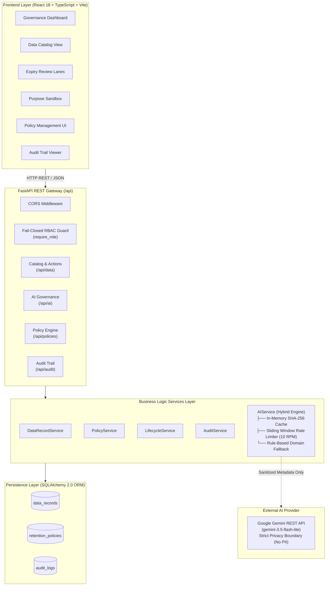

# DATAEXPIRY-AI
### AI-Assisted Data Lifecycle & Purpose Governance Platform

[](https://github.com/your-org/DATAEXPIRY-AI)
[](https://github.com/your-org/DATAEXPIRY-AI)
[](https://www.python.org/)
[](https://nodejs.org/)
[](https://www.ibm.com/it-infrastructure/linuxone)
[](LICENSE)

---

## 📌 Problem Statement

Modern enterprises ingest, store, and process massive volumes of customer, financial, employee, and transaction records across distributed databases and cloud environments. Over time, organizations face severe governance and compliance risks:
- **Data Hoarding & Sprawl:** Storing sensitive personal data indefinitely without observing lawful retention schedules.
- **Purpose Creep:** Using data collected for one legitimate purpose (e.g., Order Processing) for unauthorized secondary activities (e.g., AI model training, third-party data broker monetization, or unconsented marketing).
- **Regulatory Penalties:** Severe financial sanctions and legal exposure under GDPR (Articles 5 & 17 "Right to be Forgotten"), CCPA, and HIPAA.
- **Lack of Centralized Visibility:** Governance and privacy teams lack a real-time platform to monitor retention expiry, detect purpose divergence, and trigger auditable lifecycle actions.

---

## 💡 Why DATAEXPIRY-AI Matters

**DATAEXPIRY-AI** is a cloud-native, AI-assisted governance platform built to help enterprise privacy teams, data stewards, and auditors continuously catalog data assets, audit retention schedules, identify purpose mismatches, and execute deterministic lifecycle policies.

### Core Value Drivers:
1. **Continuous Compliance:** Real-time visibility into active, expiring-soon, and expired data assets across 5 enterprise categories.
2. **Hybrid Semantic Governance:** Combines Google Gemini LLM reasoning with a 100% offline deterministic NLP engine (functional domain clusters, creep signal heuristics, and Jaccard similarity).
3. **Fail-Closed Role-Based Security:** Fine-grained authorization preventing unauthorized deletions or unauthenticated privilege escalation.
4. **Immutable Audit Trail:** Atomic compliance logging ensuring non-repudiation for every lifecycle evaluation, approval, anonymization, and deletion.
5. **IBM LinuxONE Ready:** Designed and verified for deployment on IBM Z (`s390x`) architecture with native Python 3.12 compatibility.

---

## ✨ Core Features

- 📊 **Centralized Enterprise Data Inventory:** Searchable catalog tracking collection intents, current usages, sensitivity levels, and retention dates across Customer, Employee, Financial, Identity, and Transaction categories.
- ⏳ **Expiry Management Queue:** Prioritized 4-lane queue (`Completed`, `Expired`, `Expiring soon`, `Review required`) ensuring zero overlapping records and deterministic triage.
- 🎯 **Semantic Purpose Mismatch Detection:** NLP and AI engine detecting divergence between original consent and active operational usage.
- 🧪 **Interactive Purpose Sandbox:** Real-time evaluation sandbox to test new purpose-usage scenarios with zero database side-effects.
- 🤖 **AI Governance Insights Dashboard:** Executive KPI dashboard visualizing sensitivity distributions, risk scoring (`Critical`, `High`, `Medium`, `Low`), and advisory recommendations (`KEEP`, `REVIEW`, `ANONYMIZE`, `DELETE`).
- 🛡️ **Retention Policy Engine:** Configurable category policies with human-duration regex parsing (e.g., `"2 years"`, `"90 days"`) and automated batch evaluation.
- ⚡ **Lifecycle Action Execution:** Role-gated execution of `KEEP`, `REVIEW`, `ANONYMIZE`, and `DELETE` with mandatory confirmation dialogs and disclosure notices.
- 📜 **Immutable Audit Trail:** Searchable, filterable, and exportable JSON audit log capturing actor, action, previous/new status, timestamp, and justification.

---

## 🏛️ System Architecture



---

## 🛠️ Technology Stack

| Layer | Technologies |
| :--- | :--- |
| **Frontend** | React 18.2.0, TypeScript 5.3.3, Vite 5.4.21, Tailwind CSS 3.4.1, Lucide React 0.344.0, React Router DOM 6.22.2 |
| **Backend** | Python 3.12 / 3.13, FastAPI 0.109.0+, Starlette, Uvicorn 0.27.0+, Pydantic v2.6.0+, Pydantic-Settings 2.1.0+ |
| **ORM & Database** | SQLAlchemy 2.0.25+, SQLite 3 (local dev & tests), PostgreSQL-compatible configuration |
| **AI / NLP** | Hybrid Engine: Google Gemini REST API (`gemini-3.5-flash-lite`) + Deterministic NLP (9 domain clusters, regex creep detection, Jaccard token similarity) |
| **Testing** | Pytest 9.1.1, FastAPI TestClient (`httpx 0.26.0+`), SQLAlchemy StaticPool (`sqlite:///:memory:`) |
| **Deployment** | IBM LinuxONE (`s390x`), Ubuntu 22.04/24.04 LTS, POSIX Bash scripts, GitHub Actions CI |

---

## 📂 Repository Directory Structure

```
DATAEXPIRY-AI/
│
├── README.md                      # Comprehensive Project Documentation
├── LICENSE                        # MIT License
├── CONTRIBUTING.md                # Open-Source Contribution Guidelines
├── .gitignore                     # Git Exclusion Rules (Secrets, DBs, Caches)
├── .env.example                   # Environment Configuration Blueprint
├── .editorconfig                  # Code Style & Formatting Rules
├── pytest.ini                     # Root Test Runner Configuration
│
├── frontend/                      # React + TypeScript + Vite Single-Page Application
│   ├── public/                    # Static Public Assets (robots.txt)
│   ├── src/
│   │   ├── components/            # Reusable UI Components (Layout, Navigation)
│   │   ├── pages/                 # Application Views (Dashboard, Inventory, Expiry, Policies, Audit, etc.)
│   │   ├── services/              # API Client Layer (api.ts)
│   │   ├── types/                 # TypeScript Interfaces & Enums
│   │   ├── App.tsx                # Client-Side Routing
│   │   ├── main.tsx               # DOM Mount Entry Point
│   │   └── index.css              # Tailwind Directives & Global Styles
│   ├── package.json               # Frontend Dependencies & Scripts
│   ├── package-lock.json          # Deterministic Node Dependency Lockfile
│   ├── tsconfig.json              # TypeScript Compiler Settings
│   ├── vite.config.ts             # Vite Build & Local Reverse Proxy Config
│   └── tailwind.config.js         # Tailwind Utility Framework Config
│
├── backend/                       # FastAPI Backend Application
│   ├── app/
│   │   ├── api/                   # REST Route Handlers (routes, policy_routes, audit_routes, action_routes)
│   │   ├── core/                  # Settings, Security & RBAC Dependencies
│   │   ├── database/              # SQLAlchemy Engine & Session Generator
│   │   ├── models/                # SQLAlchemy ORM Models (data_records, retention_policies, audit_logs)
│   │   ├── schemas/               # Pydantic v2 Validation Schemas
│   │   ├── services/              # Business Logic Services (data, policy, lifecycle, audit, ai)
│   │   └── main.py                # FastAPI Application Factory & CORS Setup
│   ├── tests/                     # Automated Test Suite (127 Passing Tests)
│   │   ├── test_action_authorization.py # Exhaustive 20-combination RBAC verification
│   │   ├── test_ai_service.py     # AI NLP, rate limiting, and caching tests
│   │   ├── test_policy_engine.py  # Retention policy duration & evaluation tests
│   │   ├── test_rbac_security.py  # Security & fail-closed authorization tests
│   │   └── ...                    # API, DB, and lifecycle tests
│   ├── dataexpiry.db              # Pre-seeded SQLite demonstration database (20 records, 3 policies)
│   ├── requirements.txt           # Python Dependency Manifest
│   └── seed_db.py                 # Database Initialization & Synthetic Seed Script
│
├── docs/                          # In-Depth Technical Documentation
│   ├── architecture.md            # System Blueprint & Component Design
│   ├── installation.md            # Local Installation Guide
│   ├── api-reference.md           # REST API Endpoint Specification
│   ├── security.md                # Security, RBAC Matrix & AI Privacy Boundaries
│   ├── database.md                # Database Schema & Entity Relationships
│   ├── deployment/
│   │   └── linuxone.md            # IBM LinuxONE (s390x) Deployment Guide
│   └── audit/                     # Historical Sprint Audit Documentation
│
├── data/                          # Seed Datasets
│   ├── synthetic/
│   │   ├── records.json           # 20 Realistic Demonstration Data Records
│   │   └── generator.py           # Synthetic Record Generator Script
│   └── README.md                  # Dataset Documentation
│
├── scripts/                       # Deployment & Operational Scripts
│   ├── setup.sh                   # Automated Cross-Platform Environment Setup
│   ├── start-backend.sh           # Backend Startup Script
│   └── start-frontend.sh          # Frontend Startup Script
│
└── .github/
    └── workflows/
        └── ci.yml                 # Automated GitHub Actions CI Pipeline
```

---

## ⚡ Prerequisites

- **Python:** 3.10, 3.11, or 3.12 (Python 3.12.3 verified on IBM LinuxONE)
- **Node.js:** v18 LTS or v20 LTS
- **npm:** v9+
- **Git:** 2.30+

---

## 🚀 Local Installation & Quickstart

### Automated Setup (Linux / macOS / WSL)
```bash
git clone https://github.com/your-org/DATAEXPIRY-AI.git
cd DATAEXPIRY-AI

chmod +x scripts/*.sh
./scripts/setup.sh
```

### Manual Setup

1. **Configure Environment:**
   ```bash
   cp .env.example .env
   ```

2. **Backend Setup:**
   ```bash
   cd backend
   python3 -m venv venv
   source venv/bin/activate    # On Windows: .\venv\Scripts\Activate.ps1
   pip install --upgrade pip setuptools wheel
   pip install -r requirements.txt
   python seed_db.py
   ```

3. **Frontend Setup:**
   ```bash
   cd ../frontend
   npm ci
   npm run lint
   npm run build
   ```

---

## 🖥️ Running the Application

### Starting the Backend
```bash
# From repository root
./scripts/start-backend.sh

# Or directly via Uvicorn:
cd backend
source venv/bin/activate
uvicorn app.main:app --reload --host 0.0.0.0 --port 8000
```
- **Backend API:** `http://localhost:8000`
- **Interactive OpenAPI Documentation:** [`http://localhost:8000/docs`](http://localhost:8000/docs)

### Starting the Frontend
```bash
# In a separate terminal:
./scripts/start-frontend.sh

# Or directly via Vite:
cd frontend
npm run dev
```
- **Frontend Application:** `http://localhost:5173`

---

## ⚙️ Environment Configuration

Configuration is managed via `.env` (or environment variables). Key parameters:

| Variable | Default Value | Description |
| :--- | :--- | :--- |
| `DATABASE_URL` | `sqlite:///./dataexpiry.db` | SQLite file or PostgreSQL connection URI |
| `ENVIRONMENT` | `development` | Environment mode (`development` / `production`) |
| `ALLOW_DEV_HEADER_AUTH` | `false` | Explicit opt-in for header role assertion in dev |
| `GEMINI_API_KEY` | *(Empty)* | Optional Google Gemini API key (runs offline if unset) |
| `GEMINI_MODEL` | `gemini-3.5-flash-lite` | Gemini model identifier |
| `GEMINI_RPM_LIMIT` | `10` | Free-tier rate limit throttle |
| `GEMINI_SKIP_IDENTICAL_PURPOSE` | `false` | Evaluates records with identical purpose via Gemini |
| `CORS_ORIGINS` | `["http://localhost:5173"]` | Allowed CORS origins list |

> [!NOTE]
> The repository includes the verified demonstration database pre-seeded at `backend/dataexpiry.db` (20 records across 5 categories, 3 retention policies, 0 audit logs). When the backend is launched from `backend/`, it uses this database immediately with zero manual seeding required. To re-seed or reload synthetic data idempotently, execute `python backend/seed_db.py`.

---

## 🧪 Testing & Quality Assurance

Run the complete automated regression suite (127 tests):
```bash
# Run all tests from the repository root
pytest

# Run specific authorization test suite
pytest backend/tests/test_action_authorization.py -v
```

Run frontend linting and production build checks:
```bash
cd frontend
npm run lint    # Runs tsc --noEmit
npm run build   # Runs tsc && vite build
```

---

## 🐧 IBM LinuxONE (`s390x`) Deployment

DATAEXPIRY-AI is optimized for deployment on **IBM LinuxONE Community Cloud** running Linux on IBM Z (`s390x`):

```bash
# Clone to recommended remote path:
mkdir -p /home/linux1/datathon_project
cd /home/linux1/datathon_project
git clone https://github.com/your-org/DATAEXPIRY-AI.git DataExpiry-AI
cd DataExpiry-AI

# Execute automated LinuxONE setup:
chmod +x scripts/*.sh
./scripts/setup.sh

# Start services:
./scripts/start-backend.sh
```

For complete systemd service templates, Nginx reverse proxy configurations, and architecture-specific compiler troubleshooting, see the [IBM LinuxONE Deployment Guide](docs/deployment/linuxone.md).

---

## 🔒 Security & RBAC Overview

DATAEXPIRY-AI implements a **fail-closed, least-privilege security model**:
- **Default State:** Requests without identity headers default to `VIEWER` and are strictly barred from modifying policies or executing lifecycle actions.
- **Header Protection:** Dev headers (`X-User-Role`, `X-User-Id`) are rejected with **HTTP 403 Forbidden** unless `ALLOW_DEV_HEADER_AUTH=True` AND `ENVIRONMENT="development"`. In production, header spoofing is impossible.
- **Permission Matrix:**
  - `DELETE`: `ADMIN`, `DATA_GOVERNANCE` only.
  - `ANONYMIZE`: `ADMIN`, `DATA_GOVERNANCE`, `PRIVACY_OFFICER` only.
  - `REVIEW`: `ADMIN`, `DATA_GOVERNANCE`, `PRIVACY_OFFICER`.
  - `KEEP`: `ADMIN`, `DATA_GOVERNANCE`.
- **AI Privacy Boundary:** External LLM calls strip all PII (names, IDs, emails) and evaluate sanitized categorical metadata only.

For detailed security specifications, see [docs/security.md](docs/security.md).

---

## ⚠️ Known Limitations & Roadmap

1. **Status Simulation vs. Physical Purging:** Current lifecycle actions execute status transitions (`deletion_status = "Deleted"`, `status = "Expired"`) and record audit events. Physical database column wiping or SQL row purging is scheduled for upcoming enterprise releases.
2. **Database Migrations:** Schema creation uses `Base.metadata.create_all`. Alembic migration support is planned for PostgreSQL production instances.
3. **Identity Provider Integration:** Production deployments currently require an authenticating reverse proxy or API gateway; native OAuth2/OIDC JWT validation is planned.

---

## 👥 Team Structure & Responsibilities

| Member | Role | Focus Area |
| :--- | :--- | :--- |
| **Deeksha SN** | Project Setup & Integration | Backend foundation, DB setup, frontend architecture, integration, testing |
| **Ananya E Gowda** | AI & Insights | Purpose mismatch detection, Gemini integration, semantic heuristics |
| **Jnanika S S** | Frontend Development | Dashboard KPIs, data inventory catalog, expiry review queue |
| **Jestavi C** | Policy & Audit | Retention policies, deterministic evaluation, audit trail logging |
| **Nathin** | API Integration & Deployment | API communication, Linux setup, IBM LinuxONE deployment |
| **Manoj** | API Integration & Deployment | API communication, Linux setup, IBM LinuxONE deployment |

---

## 📄 License

This project is licensed under the MIT License — see the [LICENSE](LICENSE) file for details.
