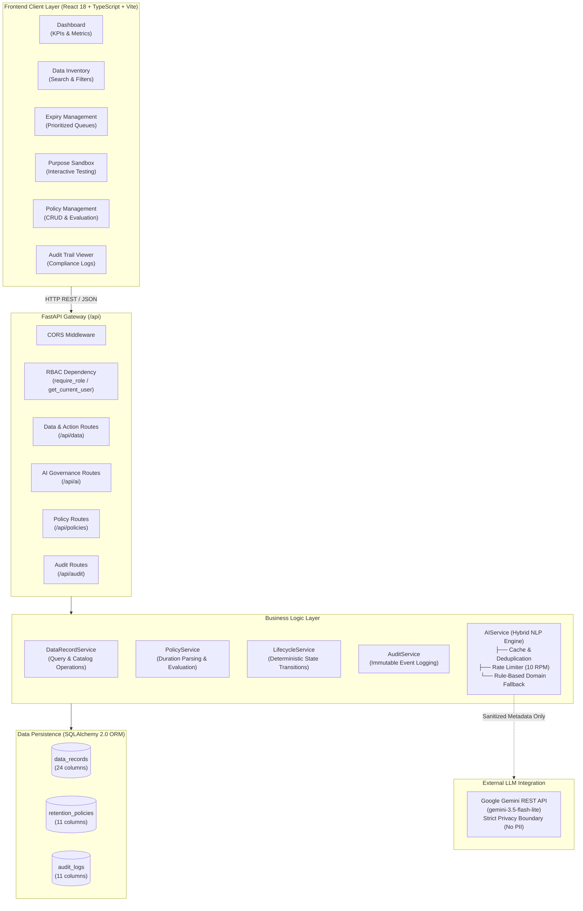

# DATAEXPIRY-AI — Architectural Blueprint & System Design

## 1. System Overview

**DATAEXPIRY-AI** is a cloud-native, AI-assisted enterprise data lifecycle and purpose governance platform. Modern enterprises collect vast amounts of sensitive customer, financial, HR, and transaction data across heterogeneous databases. Over time, organizations face severe governance challenges:
- **Data Hoarding:** Storing records beyond their statutory retention periods.
- **Purpose Creep:** Using data collected for one purpose (e.g. Order Fulfillment) for unauthorized secondary activities (e.g. Third-Party Targeted Marketing or AI model training).
- **Compliance Penalties:** Violations of GDPR (Articles 5, 17), CCPA, and enterprise retention mandates.

DATAEXPIRY-AI provides automated retention tracking, semantic drift detection between stated collection purposes and active data usage, deterministic policy evaluation, simulated lifecycle action execution (`KEEP`, `REVIEW`, `ANONYMIZE`, `DELETE`), and an immutable audit trail.

---

## 2. Architecture Diagram

---

## 3. Layered Design Principles

### A. Presentation Layer (Frontend)
- **Framework:** React 18 with TypeScript.
- **Styling:** Tailwind CSS with responsive dark/light theme support.
- **API Client:** Centralized [`apiService`](../frontend/src/services/api.ts) with typed response models, centralized error handling (`parseError`), and configurable development identity headers.

### B. Application Gateway Layer (FastAPI)
- **FastAPI Core:** Declarative routing, automatic OpenAPI 3.0 documentation (`/docs`), Pydantic v2 request/response schema validation.
- **Fail-Closed RBAC:** Dependency injection factory `require_role(...)` enforces least-privilege role verification before endpoint logic execution.

### C. Domain Services Layer
- **`DataRecordService`:** Handles CRUD and case-insensitive search across data assets.
- **`PolicyService`:** Parses human duration strings (`"2 years"` -> `730 days`) using regular expressions and matches records against category policies.
- **`LifecycleService`:** Manages deterministic lifecycle state transitions and coordinates atomic audit logging.
- **`AuditService`:** Records append-only compliance logs within the same database transaction.
- **`AIService`:** Hybrid engine combining Google Gemini with an offline, deterministic semantic analyzer.

### D. Persistence Layer (SQLAlchemy 2.0)
- **Development Database:** SQLite with thread-safe connection pooling.
- **Production Readiness:** Direct compatibility with PostgreSQL via the `DATABASE_URL` environment variable.
