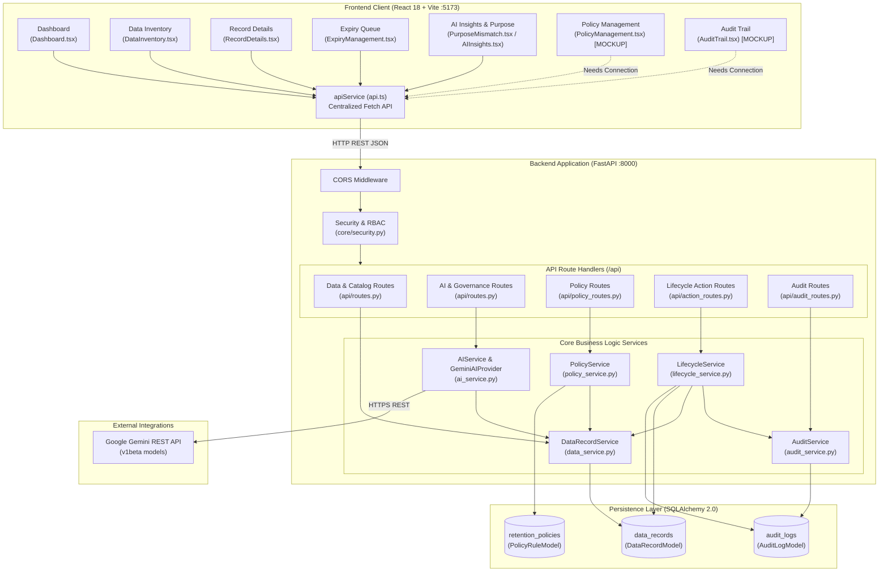
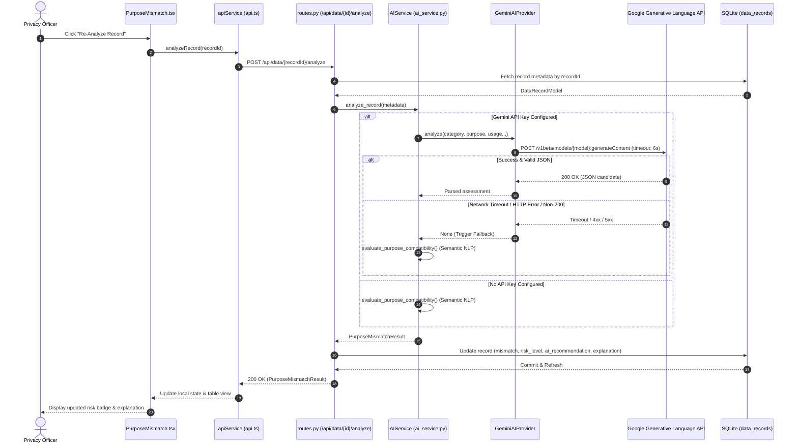
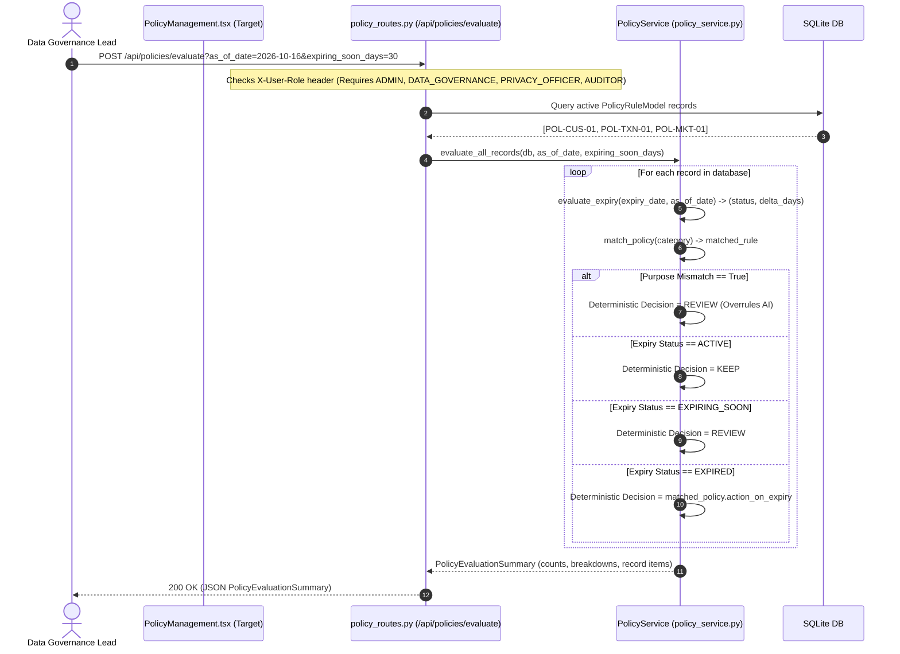
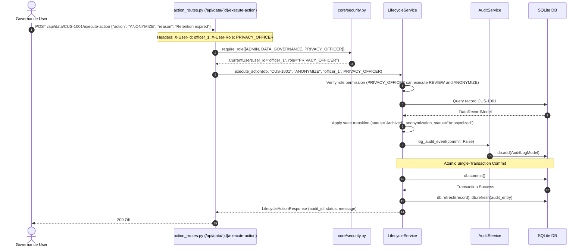
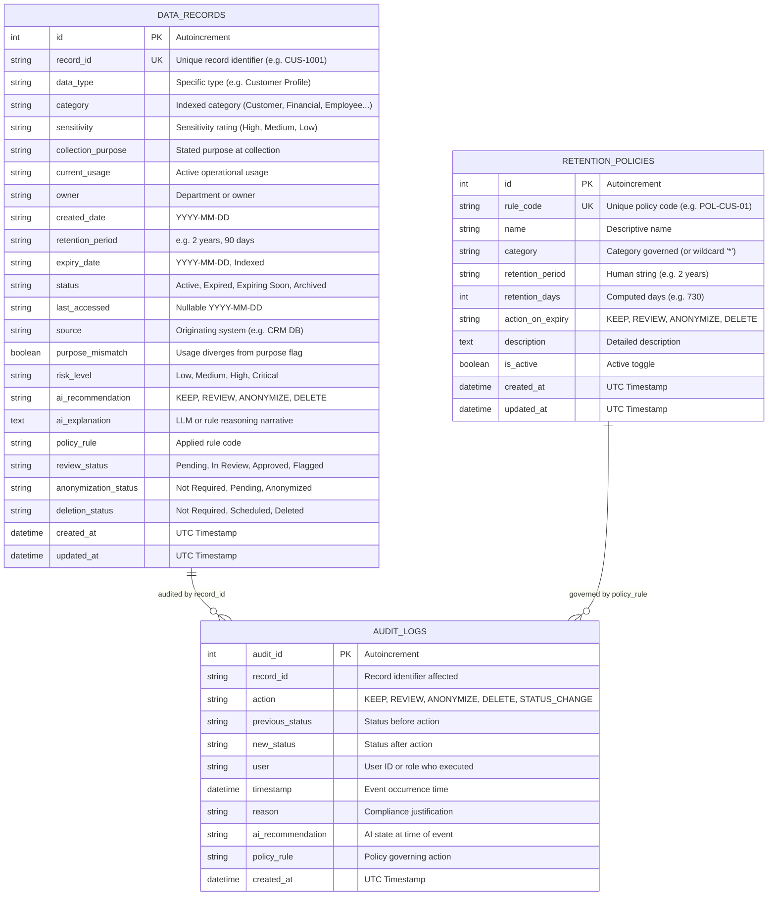

# DATAEXPIRY — Technical Architecture & Component Blueprint

**Document Version:** 1.0.0  
**Target Audience:** Staff Engineers, ChatGPT pair-programming agents, Frontend/Backend developers  
**Status:** Audit Reconstructed Architecture

---

## 1. High-Level System Architecture

DATAEXPIRY is structured as a modern decoupled client-server architecture consisting of three primary layers:
1. **Frontend Presentation Layer:** Single-Page Application (SPA) built with React 18, TypeScript, Tailwind CSS, and Vite.
2. **Backend Application Layer:** High-performance asynchronous API built with FastAPI, Pydantic v2, and SQLAlchemy 2.0.
3. **Storage & Engine Layer:** Relational persistence (SQLite default, PostgreSQL ready), an NLP semantic analysis engine, and deterministic policy rule governance.



---

## 2. Component Directory & File Responsibility Map

```
DataExpiry-AI-main/
│
├── backend/
│   ├── app/
│   │   ├── main.py                   # FastAPI Application Entrypoint, CORS, and Router mounting
│   │   ├── api/
│   │   │   ├── routes.py             # Health check, Data Record CRUD, AI Batch & Sandbox endpoints
│   │   │   ├── policy_routes.py      # Retention Policy CRUD and Policy Evaluation endpoints
│   │   │   ├── action_routes.py      # Lifecycle Action execution (KEEP, REVIEW, ANONYMIZE, DELETE)
│   │   │   ├── audit_routes.py       # Immutable audit log query endpoints
│   │   │   └── __init__.py           # Route exports
│   │   ├── core/
│   │   │   ├── config.py             # Pydantic BaseSettings (env loading, CORS, Gemini keys)
│   │   │   └── security.py           # Header-based RBAC dependencies (UserRole, require_role)
│   │   ├── database/
│   │   │   └── session.py            # SQLAlchemy Engine, SessionLocal, Base, get_db dependency
│   │   ├── models/
│   │   │   ├── data_record.py        # DataRecordModel table definition (data_records)
│   │   │   ├── policy.py             # PolicyRuleModel table definition (retention_policies)
│   │   │   ├── audit.py              # AuditLogModel table definition (audit_logs)
│   │   │   └── __init__.py           # Model exports
│   │   ├── schemas/
│   │   │   ├── data_record.py        # Pydantic schemas for data records and AI responses
│   │   │   ├── policy.py             # Pydantic schemas for policies and evaluation items
│   │   │   ├── audit.py              # Pydantic schemas for audit log responses & filters
│   │   │   ├── action.py             # Pydantic schemas for lifecycle action requests/responses
│   │   │   └── __init__.py           # Schema exports
│   │   └── services/
│   │       ├── data_service.py       # DataRecord CRUD and query filtering
│   │       ├── ai_service.py         # Purpose mismatch semantic NLP, keyword clustering, Gemini client
│   │       ├── policy_service.py     # Retention duration parser, expiry evaluator, policy matching
│   │       ├── lifecycle_service.py  # Action executor with atomic audit logging & RBAC checks
│   │       ├── audit_service.py      # Immutable audit log creation and query retrieval
│   │       └── __init__.py           # Service exports
│   ├── tests/                        # 9 automated test suites covering all backend modules
│   ├── seed_db.py                    # SQLite database initializer and synthetic data seeder
│   └── requirements.txt              # Python dependency manifest
│
├── frontend/
│   ├── src/
│   │   ├── components/
│   │   │   ├── Layout.tsx            # App chrome, dark mode toggle, backend connectivity badge
│   │   │   └── Navigation.tsx        # Persistent sidebar navigation links
│   │   ├── pages/
│   │   │   ├── Dashboard.tsx         # Overview metrics, distribution bars, KPI tiles
│   │   │   ├── DataInventory.tsx     # Filterable data catalog table
│   │   │   ├── RecordDetails.tsx     # Single record profile lookup & AI assessment viewer
│   │   │   ├── ExpiryManagement.tsx  # 4 status lanes (Expiring Soon, Expired, Review, Completed)
│   │   │   ├── PurposeMismatch.tsx   # Purpose creep monitoring, batch audit, and sandbox
│   │   │   ├── AIInsights.tsx        # AI lifecycle insights, action cards, explanation drawer
│   │   │   ├── PolicyManagement.tsx  # [STATIC PLACEHOLDER] Needs API integration
│   │   │   └── AuditTrail.tsx        # [STATIC PLACEHOLDER] Needs API integration
│   │   ├── services/
│   │   │   └── api.ts                # Centralized Fetch API client class
│   │   ├── types/
│   │   │   └── index.ts              # TypeScript interfaces for records, AI, health
│   │   ├── App.tsx                   # React Router DOM route declarations
│   │   └── main.tsx                  # React DOM root render
│   ├── package.json                  # Node dependency manifest
│   ├── vite.config.ts                # Vite dev server configuration and `/api` reverse proxy
│   └── tailwind.config.js            # Tailwind CSS styling configuration
│
├── data/
│   ├── synthetic/
│   │   ├── records.json              # 20 pre-generated synthetic records for seeding
│   │   └── generator.py              # CLI utility to generate 100+ synthetic records
│   └── README.md                     # Dataset documentation
│
└── docs/
    └── ARCHITECTURE.md               # Foundational architecture notes from team member 1
```

---

## 3. Detailed Data Flow & Call Sequences

### A. AI Purpose Mismatch Audit Flow



---

### B. Retention Policy Evaluation Sequence



---

### C. Atomic Lifecycle Action Execution & Audit Trail Flow



---

## 4. Database Schema & Persistence Architecture

The system uses SQLAlchemy 2.0 ORM with declarative models located in `backend/app/models/`.



---

## 5. Authentication, RBAC, and Security Architecture

### Role-Based Access Control Structure (`backend/app/core/security.py`)

Five distinct user roles are defined:
- `ADMIN`: Unrestricted access. Can modify policies, execute all actions (including DELETE), and view audit trails.
- `DATA_GOVERNANCE`: Can configure retention policies, run evaluations, and execute actions.
- `PRIVACY_OFFICER`: Focused on compliance. Permitted to execute `REVIEW` and `ANONYMIZE`. Explicitly forbidden from executing `DELETE`.
- `AUDITOR`: Read-only compliance auditor. Can view policies, run read-only evaluations, and inspect audit logs. Forbidden from mutating records or executing actions.
- `VIEWER`: Read-only access to policies.

### Action Permissions by Role:

| Action | `ADMIN` | `DATA_GOVERNANCE` | `PRIVACY_OFFICER` | `AUDITOR` | `VIEWER` |
| :--- | :---: | :---: | :---: | :---: | :---: |
| `KEEP` | Allowed | Allowed | Denied | Denied | Denied |
| `REVIEW` | Allowed | Allowed | Allowed | Denied | Denied |
| `ANONYMIZE` | Allowed | Allowed | Allowed | Denied | Denied |
| `DELETE` | Allowed | Allowed | **Denied (403)** | Denied | Denied |

### The Critical Security Flaw (Header Extraction Fallback):
```python
def get_current_user(
    x_user_id: Optional[str] = Header(None, alias="X-User-Id"),
    x_user_role: Optional[str] = Header(None, alias="X-User-Role")
) -> CurrentUser:
    user_id = x_user_id.strip() if x_user_id and x_user_id.strip() else "local_dev_user"
    if x_user_role and x_user_role.strip():
        role = UserRole(x_user_role.strip().upper())
    else:
        role = UserRole.ADMIN  # <--- CRITICAL INSECURE DEFAULT
    return CurrentUser(user_id=user_id, role=role)
```
- **Consequence:** Requests without headers automatically receive `ADMIN` rights. Any client can spoof identity by passing arbitrary strings in `X-User-Id` and `X-User-Role`. Real authentication (JWT, OAuth2, session cookies) is completely absent.
