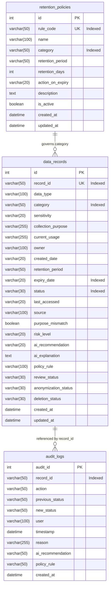

# DATAEXPIRY-AI — Database Architecture & Schema Specification

This document details the database schemas, indexing strategy, data models, and seeding mechanisms in **DATAEXPIRY-AI**.

---

## 1. Schema Definitions



---

## 2. Table Specifications

### A. `data_records`
Main catalog tracking enterprise data assets, collection intents, current usages, retention schedules, and governance evaluations.

| Column | Type | Constraints | Description |
| :--- | :--- | :--- | :--- |
| `id` | Integer | PK, Autoincrement | Internal primary key |
| `record_id` | String(50) | Unique, Indexed, Not Null | Public record identifier (e.g. `CUS-1001`) |
| `data_type` | String(100) | Not Null | Data type (e.g. `Customer Profile`, `Payroll Record`) |
| `category` | String(50) | Not Null, Indexed | Operational category (`Customer`, `Financial`, `Employee`, `Identity`, `Transaction`) |
| `sensitivity` | String(20) | Not Null | Classification (`High`, `Medium`, `Low`) |
| `collection_purpose` | String(255) | Not Null | Stated purpose at collection time |
| `current_usage` | String(255) | Not Null | Active operational usage |
| `owner` | String(100) | Not Null | Department or owner (e.g. `Customer Operations`) |
| `created_date` | String(20) | Not Null | Creation date (`YYYY-MM-DD`) |
| `retention_period` | String(50) | Not Null | Declared retention period (`2 years`, `90 days`) |
| `expiry_date` | String(20) | Not Null, Indexed | Calculated expiry date (`YYYY-MM-DD`) |
| `status` | String(30) | Not Null, Indexed | State (`Active`, `Expired`, `Expiring Soon`, `Archived`) |
| `last_accessed` | String(20) | Nullable | Last access timestamp |
| `source` | String(100) | Not Null | Ingest source (e.g. `CRM DB`, `Workday Vault`) |
| `purpose_mismatch` | Boolean | Default: False | Flagged if current usage diverges from purpose |
| `risk_level` | String(20) | Default: "Low" | Risk rating (`Critical`, `High`, `Medium`, `Low`) |
| `ai_recommendation` | String(20) | Default: "KEEP" | Advisory recommendation (`KEEP`, `REVIEW`, `ANONYMIZE`, `DELETE`) |
| `ai_explanation` | Text | Nullable | Natural language governance rationale |
| `policy_rule` | String(100) | Nullable | Governing retention policy rule code |
| `review_status` | String(30) | Default: "Pending" | Review state (`Pending`, `In Review`, `Approved`, `Flagged`) |
| `anonymization_status` | String(30) | Default: "Not Required"| State (`Not Required`, `Pending`, `Anonymized`) |
| `deletion_status` | String(30) | Default: "Not Required"| State (`Not Required`, `Scheduled`, `Deleted`) |
| `created_at` | DateTime | Not Null, Default: UTC now | Row creation timestamp |
| `updated_at` | DateTime | Not Null, Default: UTC now | Row update timestamp |

---

### B. `retention_policies`
Defines enterprise retention rules mapped to operational data categories.

| Column | Type | Constraints | Description |
| :--- | :--- | :--- | :--- |
| `id` | Integer | PK, Autoincrement | Internal primary key |
| `rule_code` | String(50) | Unique, Indexed, Not Null | Unique rule code (e.g. `POL-CUS-01`) |
| `name` | String(100) | Not Null | Descriptive policy title |
| `category` | String(50) | Not Null, Indexed | Target category |
| `retention_period` | String(50) | Not Null | Human-readable duration (`2 years`, `180 days`) |
| `retention_days` | Integer | Not Null | Computed numeric days used in evaluations |
| `action_on_expiry` | String(20) | Not Null | Action on expiry (`KEEP`, `REVIEW`, `ANONYMIZE`, `DELETE`) |
| `description` | Text | Nullable | Legal or compliance rationale |
| `is_active` | Boolean | Not Null, Default: True | Active toggle (soft deletion sets False) |
| `created_at` | DateTime | Not Null, Default: UTC now | Policy creation timestamp |
| `updated_at` | DateTime | Not Null, Default: UTC now | Policy modification timestamp |

---

### C. `audit_logs`
Immutable compliance audit trail capturing all lifecycle events, evaluations, and manual overrides.

| Column | Type | Constraints | Description |
| :--- | :--- | :--- | :--- |
| `audit_id` | Integer | PK, Autoincrement | Immutable audit sequence ID |
| `record_id` | String(50) | Not Null, Indexed | Target record identifier |
| `action` | String(50) | Not Null | Action executed (`KEEP`, `REVIEW`, `ANONYMIZE`, `DELETE`, `EVALUATE`) |
| `previous_status` | String(50) | Nullable | Record status prior to action |
| `new_status` | String(50) | Nullable | Record status after action |
| `user` | String(100) | Not Null | Actor who authorized the action |
| `timestamp` | DateTime | Not Null, Default: UTC now | Timestamp of event occurrence |
| `reason` | String(255) | Nullable | User justification or policy trigger note |
| `ai_recommendation` | String(50) | Nullable | Advisory AI recommendation at execution time |
| `policy_rule` | String(50) | Nullable | Applicable policy rule at execution time |
| `created_at` | DateTime | Not Null, Default: UTC now | Creation timestamp |

---

## 3. Database Initialization & Seeding

The database is initialized and seeded using [`backend/seed_db.py`](../backend/seed_db.py):
```bash
python backend/seed_db.py
```
This script:
1. Calls `Base.metadata.create_all(bind=engine)` to create all tables and indexes.
2. Reads 20 realistic synthetic records from `data/synthetic/records.json` and inserts them into `data_records` (skipping duplicates).
3. Inserts demonstration retention policies (`POL-CUS-01`, `POL-TXN-01`, `POL-MKT-01`) into `retention_policies`.
