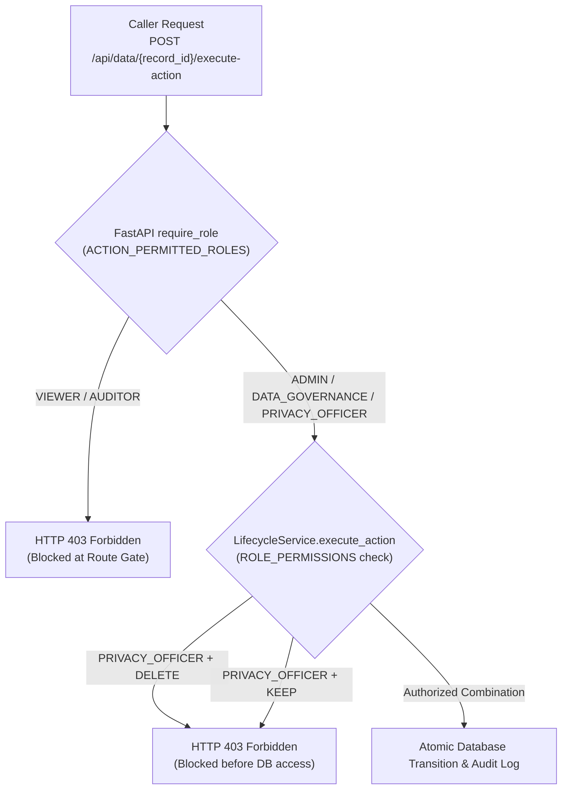

# DATAEXPIRY-AI — Security Architecture & RBAC Specification

This document details the security controls, role-based access control (RBAC) architecture, authentication design, and data privacy boundaries implemented in **DATAEXPIRY-AI**.

---

## 1. Role-Based Access Control (RBAC)

The platform enforces five distinct enterprise roles defined in [`backend/app/core/security.py`](../backend/app/core/security.py):

| Role | Role Code | Responsibilities |
| :--- | :--- | :--- |
| **Administrator** | `ADMIN` | Full administrative access to policies, record actions, and audit logs. |
| **Data Governance Lead** | `DATA_GOVERNANCE` | Retention policy management, lifecycle action execution, and governance reporting. |
| **Privacy Officer** | `PRIVACY_OFFICER` | Compliance reviews, anonymization triggers, and audit inspection. Forbidden from executing `DELETE`. |
| **Auditor** | `AUDITOR` | Read-only inspection of immutable audit logs and policy evaluation results. Cannot modify policies or execute actions. |
| **Viewer** | `VIEWER` | Read-only inspection of catalog records. Fails closed on all privileged operations. |

---

## 2. Lifecycle Action Authorization Matrix

Lifecycle action permissions are enforced at two levels: (1) the route dependency gate and (2) service-level permission checking:

| Lifecycle Action | `ADMIN` | `DATA_GOVERNANCE` | `PRIVACY_OFFICER` | `AUDITOR` | `VIEWER` |
| :--- | :---: | :---: | :---: | :---: | :---: |
| **`KEEP`** | ✅ 200 OK | ✅ 200 OK | ❌ 403 Forbidden | ❌ 403 Forbidden | ❌ 403 Forbidden |
| **`REVIEW`** | ✅ 200 OK | ✅ 200 OK | ✅ 200 OK | ❌ 403 Forbidden | ❌ 403 Forbidden |
| **`ANONYMIZE`** | ✅ 200 OK | ✅ 200 OK | ✅ 200 OK | ❌ 403 Forbidden | ❌ 403 Forbidden |
| **`DELETE`** | ✅ 200 OK | ✅ 200 OK | ❌ 403 Forbidden | ❌ 403 Forbidden | ❌ 403 Forbidden |

### Enforcement Architecture

---

## 3. Development Identity vs. Production Authentication

### Development Mode Behavior
- Header-based identity assertion (`X-User-Role`, `X-User-Id`) is available strictly for local development and integration testing.
- **Fail-Closed Safeguard:** By default, `ALLOW_DEV_HEADER_AUTH=False`. If headers are supplied without explicit opt-in, the request is rejected with **HTTP 403 Forbidden**.
- If headers are absent, caller identity defaults to `local_dev_user` with the read-only `VIEWER` role. Unauthenticated requests fail closed on all privileged operations.

### Production Deployment Security Requirements
Before exposing DATAEXPIRY-AI to external production networks:
1. `ALLOW_DEV_HEADER_AUTH` must remain `False`.
2. Connect an authenticating reverse proxy (e.g., Nginx, Envoy, OAuth2 Proxy, IBM Cloud IAM) or configure JWT bearer token validation.
3. Configure explicit CORS origins (`CORS_ORIGINS`) to prevent unauthorized cross-origin requests.

---

## 4. External AI Privacy Boundary

When interacting with the Google Gemini LLM API, strict data minimization and privacy boundaries are enforced:

1. **PII Stripping:** Record IDs, customer names, email addresses, phone numbers, and physical addresses are strictly excluded from external prompts.
2. **Metadata-Only Processing:** Only general operational descriptions (`category`, `sensitivity`, `collection_purpose`, `current_usage`, `status`, `expiry_date`) are evaluated.
3. **Offline Fallback Guarantee:** If no API key is provided, or if the network is unavailable, the system transparently utilizes the internal deterministic rule engine. No data leaves the local infrastructure.

---

## 5. Audit Non-Repudiation & Immutability

- **Atomicity:** Lifecycle status changes and audit log entries are committed within the same database transaction (`commit=False` during event generation, finalized by session commit).
- **Append-Only:** The `audit_logs` table has no `UPDATE` or `DELETE` API endpoints. Once created, compliance records cannot be modified via the application layer.
